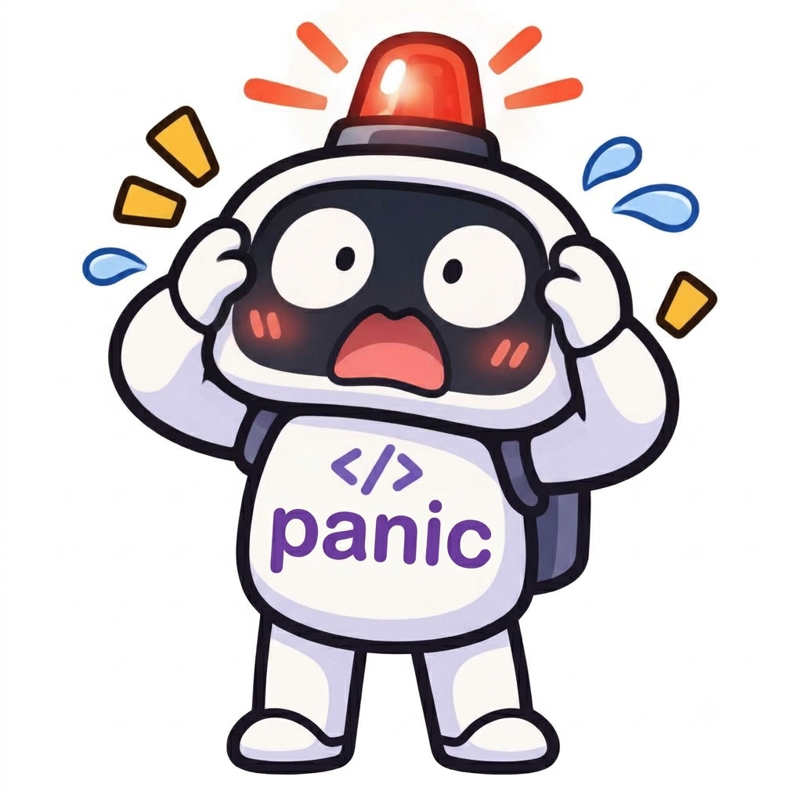
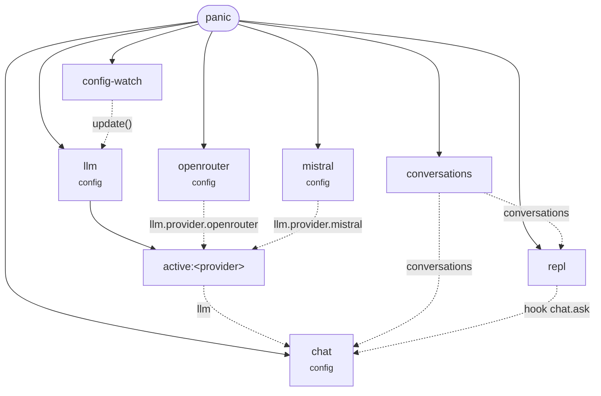

<!-- prettier-ignore -->
<div align="center">



# Panic

*An LLM assistant built as a tree of hot-swappable plugins on the z lifecycle kernel*

[](https://adoptium.net)
[](https://gradle.org)
[](https://github.com/iimvh/z)
[](https://openrouter.ai)
[](https://mistral.ai)

[Overview](#overview) • [Getting started](#getting-started) • [Usage](#usage) • [How it works](#how-it-works) • [Project structure](#project-structure) • [Development](#development) • [Troubleshooting](#troubleshooting)

</div>

## Overview

**Panic** is a chat assistant where every part of the app is a **plugin** in a lifecycle tree. Plugins never call each other directly. They talk through **services**, **hooks** and **events** from [z](https://github.com/iimvh/z), a small Java kernel inspired by [cordis](https://github.com/cordiverse/cordis).

Because of that, the tree heals itself. Remove an API key and the parts that need an LLM stop. Add it back and they start again. Switch model while chatting and only the affected branch restarts, so the conversation is kept.

- **Two providers out of the box:** [OpenRouter](https://openrouter.ai) and [Mistral](https://mistral.ai), both through one OpenAI-compatible client.
- **Streaming replies.** Answers stream over SSE, and stopping a reply aborts its HTTP request.
- **Hot reload.** Save `panic.json` and only the changed sections are applied.
- **Terminal chat bot.** A REPL with commands to switch provider and model, list models and check keys.
- **Minimal stack.** Plain Java 21 and Gradle, with Jackson as the only library.

> [!NOTE]
> This is the first stage of a rebuild. It covers LLM providers and a terminal bot only. The web UI and the agents come in later stages.

## Getting started

### Prerequisites

- **JDK 21.** If the machine only has a JRE, Gradle finds or downloads a JDK through `gradle/gradle-daemon-jvm.properties`.
- **An API key** from [OpenRouter](https://openrouter.ai/keys) (free models are available) and/or [Mistral](https://console.mistral.ai/api-keys).

### Install

z is a git submodule, so clone with `--recurse-submodules`:

```bash
git clone --recurse-submodules https://github.com/iimvh/agent-panic.git
cd agent-panic
```

> [!TIP]
> Already cloned without submodules? Run `git submodule update --init`.

### Configure

```bash
cp panic.example.json panic.json
export OPENROUTER_API_KEY=sk-or-...   # and/or MISTRAL_API_KEY
```

`panic.json` is git-ignored. Any string in it can reference an environment variable as `${NAME}`, so keys stay out of the file:

```json
{
  "providers": {
    "openrouter": { "apiKey": "${OPENROUTER_API_KEY}" },
    "mistral": { "apiKey": "${MISTRAL_API_KEY}" }
  },
  "llm": { "provider": "openrouter", "model": "meta-llama/llama-3.3-70b-instruct:free", "temperature": 0.2, "maxTokens": 4096 },
  "chat": { "systemPrompt": "You are Panic, a concise and helpful assistant.", "maxHistory": 40 }
}
```

| Key | Meaning |
| --- | --- |
| `providers.<id>.apiKey` | Credential. If it is blank, the provider is not connected. |
| `providers.<id>.baseUrl` | Optional endpoint override, for example a proxy. |
| `llm.provider`, `llm.model` | The provider and model to chat with. |
| `llm.temperature`, `llm.maxTokens` | Default options. Leave them out to use the provider's defaults. |
| `chat.systemPrompt` | System message sent with every request. |
| `chat.maxHistory` | Number of past messages sent with each request. `0` sends them all. |

> [!TIP]
> Without `panic.json`, Panic reads `OPENROUTER_API_KEY`, `MISTRAL_API_KEY` and `PANIC_MODEL` from the environment.

### Run

```bash
./gradlew :app:run -q --console=plain
```

Or build a launcher once and run it directly:

```bash
./gradlew :app:installDist
app/build/install/app/bin/app [path/to/panic.json]
```

## Usage

```text
panic — type a message, or /help
provider: openrouter   model: meta-llama/llama-3.3-70b-instruct:free   (connected)

> What is a virtual thread?
A lightweight thread managed by the JVM rather than the OS...
[meta-llama/llama-3.3-70b-instruct:free · 184 tokens]

> /provider mistral
> /model mistral-small-latest
```

| Command | Description |
| --- | --- |
| `/provider [id]` | Show or switch the provider (`openrouter`, `mistral`) |
| `/model [id]` | Show or switch the model |
| `/models [free\|text]` | List the provider's models: free ones only, or ids containing `text` |
| `/check` | Check the API key against the provider |
| `/status` | Show what is connected |
| `/reset` | Forget the conversation |
| `/exit` | Quit. Ctrl+C also shuts down cleanly. |

Edit `panic.json` while Panic is running and the change is applied as soon as you save. Only the plugins whose section changed are restarted. A model picked with `/model` stays selected when you edit other sections of the file.

## How it works



Solid lines show ownership in the tree. Dotted lines show the services and hooks that connect plugins.

| Plugin | Role |
| --- | --- |
| `openrouter`, `mistral` | Provide `llm.provider.<id>` while they have a key. |
| `llm` | Installs `active:<provider>`, which requires that provider and provides `llm` with the chosen model and options. |
| `conversations` | Keeps chat history in memory. It does not depend on the LLM, so history survives a switch. |
| `chat` | Requires `llm` and `conversations`. Answers the `chat.ask` hook and emits `chat.turn` after each exchange. |
| `config-watch` | Watches `panic.json` and updates only the configs that changed. |
| `repl` | Reads stdin and asks `chat.ask`. When no LLM is connected it gets no answer and keeps running. |

The z kernel provides these guarantees, so Panic has no code for them:

- **Dependents stop first.** When a provider is retracted, `chat` stops before `llm` does.
- **Nothing runs after teardown.** A reply that is still streaming is cancelled, and teardown waits for it to return.
- **Restarts stay in one branch.** Changing a config restarts only that plugin and the plugins that depend on it.

## Project structure

```text
├── llm/      panic.llm   ChatModel, Provider, Llm; OpenAiCompatClient (SSE, cancellable); OpenRouter, Mistral, LlmPlugin
├── chat/     panic.chat  Conversations, ChatPlugin, Chat (hook ASK, event TURN)
├── app/      panic.app   ConfigLoader, Panic (the tree), ConfigWatch, Repl, Main
├── buildSrc/             Shared conventions: Java 21, -Xlint:all -Werror, JUnit 5
└── z/                    The z kernel (git submodule, consumed as a Gradle composite build)
```

## Development

```bash
./gradlew check   # all tests
```

Compiler warnings are errors. The tests run against local fake HTTP servers, so they need no network and no API keys. They cover the SSE parser, content normalization, request cancellation, provider switching and retraction, chat history, hot reload and an end-to-end REPL session.

To add a provider, write a `ConfigPlugin<ProviderConfig>` that provides `Providers.key("<id>")` and register it in `Panic`. For an OpenAI-compatible API, extend `OpenAiCompatProvider`. [`Mistral.java`](llm/src/main/java/panic/llm/Mistral.java) is a complete example in about 50 lines.

## Troubleshooting

> [!WARNING]
> **`Toolchain installation ... does not provide the required capabilities: [JAVA_COMPILER]`**
> Gradle is running on a JRE. Keep `gradle/gradle-daemon-jvm.properties` in place so Gradle can pick or download a JDK 21, or point `JAVA_HOME` at a JDK. Then run `./gradlew --stop` and try again.

- **`[no LLM connected]`.** The selected provider has no key, or no provider is selected. Run `/status`, then set the key or use `/provider`.
- **`openrouter answered 404: No endpoints found ...`.** The model id is wrong or the model is no longer available. Run `/models free` to see what you can use.
- **`z` directory is empty.** Run `git submodule update --init`.
