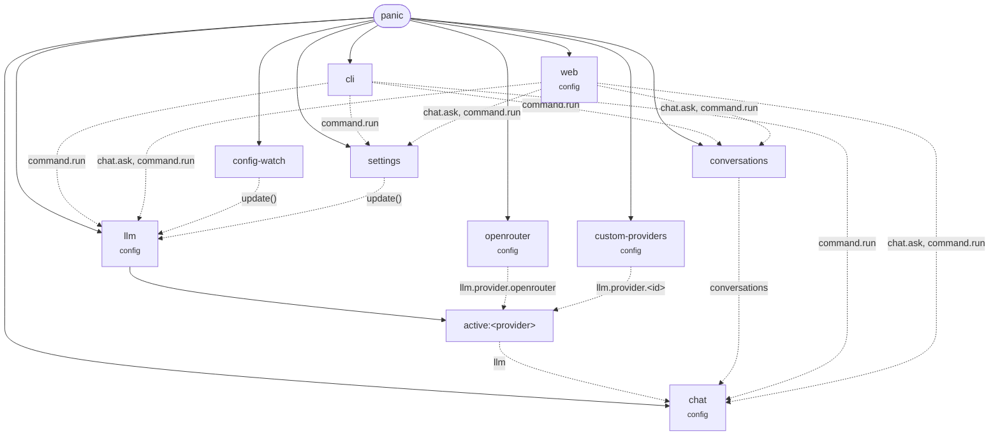

<!-- prettier-ignore -->
<div align="center">


# Panic

*An LLM assistant, in the terminal and the browser, built as a tree of hot-swappable plugins on the z lifecycle kernel*

[](https://github.com/iimvh/agent-panic/actions/workflows/ci.yml)
[](https://adoptium.net)
[](https://gradle.org)
[](https://github.com/iimvh/z)
[](https://openrouter.ai)
[](https://mistral.ai)
[](https://svelte.dev)

[Overview](#overview) • [Getting started](#getting-started) • [Usage](#usage) • [How it works](#how-it-works) • [Writing a plugin](#writing-a-plugin) • [Project structure](#project-structure) • [Development](#development) • [Troubleshooting](#troubleshooting)

</div>

## Overview

**Panic** is a chat assistant where every part of the app is a **plugin** in a lifecycle tree. Plugins never call each other directly. They talk through **services**, **hooks** and **events** from [z](https://github.com/iimvh/z), a small Java kernel inspired by [cordis](https://github.com/cordiverse/cordis).

Because of that, the tree heals itself. Remove an API key and the parts that need an LLM stop. Add it back and they start again. Switch model while chatting and only the affected branch restarts, so the conversation is kept.

- **Any OpenAI-compatible provider:** [OpenRouter](https://openrouter.ai) built in; Mistral, Ollama or any other OpenAI-compatible API is a config entry, all through one client.
- **Streaming replies.** Answers stream over SSE, and stopping a reply aborts its HTTP request.
- **Plugins are discovered.** Drop a module into `plugins/` and it is built, found and installed. Its config is the `panic.json` section with its name, and no wiring code is needed.
- **Hot reload.** Save `panic.json` and only the plugins whose section changed are reconfigured, installed or removed.
- **Koishi-style commands.** Each plugin declares its own commands, and a command exists only while its plugin runs.
- **Two front-ends, both plugins.** A terminal CLI (interactive or one command at a time) and a web UI. Both own no feature: they run whatever the other plugins offer right now.
- **Minimal stack.** Plain Java 21 and Gradle, with Jackson as the only library. The web UI is a SvelteKit SPA of about 190 KB, packed into the jar.

> [!NOTE]
> The rebuild is in progress. It covers LLM providers, the chat bot, the CLI and the web UI. Agents come in a later stage.

## Getting started

### Prerequisites

- **JDK 21.** If the machine only has a JRE, Gradle finds or downloads a JDK through `gradle/gradle-daemon-jvm.properties`.
- **Node.js 20+** to build the web UI. Without it, pass `-PskipUi`: everything else still builds, and the server shows a "UI not built" page.
- **An API key** from [OpenRouter](https://openrouter.ai/keys) (free models are available) and/or [Mistral](https://console.mistral.ai/api-keys), or a local [Ollama](https://ollama.com) (no key).

### Install

z is a git submodule, so clone with `--recurse-submodules`:

```bash
git clone --recurse-submodules https://github.com/iimvh/agent-panic.git
cd agent-panic
```

> [!TIP]
> Already cloned without submodules? Run `git submodule update --init`.

### Configure

```bash
cp panic.example.json panic.json
export OPENROUTER_API_KEY=sk-or-...   # and/or MISTRAL_API_KEY (used by the custom-providers entry)
```

`panic.json` is git-ignored. It has **one section per plugin, named after the plugin**. A missing section means the plugin's defaults, and `false` turns the plugin off. Any string can reference an environment variable as `${NAME}`, so keys stay out of the file:

```json
{
  "openrouter": { "apiKey": "${OPENROUTER_API_KEY}" },
  "custom-providers": { "providers": { "mistral": { "baseUrl": "https://api.mistral.ai/v1", "apiKey": "${MISTRAL_API_KEY}" } } },
  "llm": { "provider": "openrouter", "model": "meta-llama/llama-3.3-70b-instruct:free", "temperature": 0.2, "maxTokens": 4096 },
  "chat": { "systemPrompt": "You are Panic, a concise and helpful assistant.", "maxHistory": 40 },
  "web": { "enabled": false, "host": "127.0.0.1", "port": 8080 }
}
```

| Key | Meaning |
| --- | --- |
| `openrouter.apiKey` | Credential. If it is blank, the provider is not connected. |
| `openrouter.baseUrl` | Optional endpoint override, for example a proxy. |
| `custom-providers.providers` | OpenAI-compatible providers by id: `baseUrl`, optional `apiKey` (left out = no key needed, blank = not connected), `maxRetries`, `enabled`. See [plugins/llm](plugins/llm/README.md#custom-providers). |
| `llm.provider`, `llm.model` | The provider and model to chat with. |
| `llm.temperature`, `llm.maxTokens` | Default options. Leave them out to use the provider's defaults. |
| `chat.systemPrompt` | System message sent with every request. |
| `chat.maxHistory` | Number of past messages sent with each request. `0` sends them all. |
| `conversations.dir`, `conversations.persist` | Where chat history is saved (default `.panic/conversations`, one JSON lines file per conversation), so it survives a restart. `persist: false` keeps it in memory only. |
| `tracing.dir`, `tracing.keepDays`, `tracing.maxTraces` | Where the trace of every turn is saved (default `.panic/traces`, one JSON lines file per conversation), how many days to keep it (default 30, `0` = forever) and how many traces to keep per conversation (default 500). `"tracing": false` keeps none. |
| `workspace.dir` | Where the projects (folders a chat works in) are saved (default `.panic/workspace`). `folder-picker.enabled` (default true) lets the server open the system's folder dialog for "Add project"; turn it off when Panic runs on another machine than the browser. |
| `todo.dir`, `todo.maxItems` | Where the agent's task lists are saved (default `.panic/todo`) and how many tasks one list may hold. |
| `instructions.global`, `instructions.names`, `instructions.maxChars` | Instruction files sent to the agent: your own (default `.panic/AGENTS.md`), then the first of `names` (default `AGENTS.md`, `CLAUDE.md`) in each folder from the repository root down to the chat's project, at most `maxChars` (default 12000) in all. `"instructions": false` sends none. |
| `skills.global`, `skills.dirs`, `skills.maxListChars` | Skills (folders with a `SKILL.md`): your own in `global` (default `.panic/skills`), a project's in `dirs` under it (default `.panic/skills`, `.agents/skills`, `.claude/skills`, so skills written for Claude Code or Codex work). Only their names and descriptions go into the prompt (at most `maxListChars`, default 6000); the agent loads one with the `skill` tool and you run one with `/name args`. See [plugins/skills](plugins/skills/README.md). |
| `memory.dir`, `memory.maxIndexChars`, `memory.maxFileChars` | Where the agent's long-term memories are saved (default `.panic/memory`: `user/` for every chat, `projects/<name>-<hash>/` per project), how much of each `MEMORY.md` index goes into every prompt (default 6000 chars) and the largest memory file (default 20000). Each memory the agent saves is asked unless `permissions.tools.memory_edit` is `allow`. See [plugins/memory](plugins/memory/README.md). |
| `shell.dir`, `shell.timeoutSeconds`, `shell.maxTimeoutSeconds`, `shell.maxBackground`, `shell.deny` | Shell commands the agent runs (`exec`): where when the chat has no project (default `.`), time limits (default 120 s, at most 600 s), background jobs per chat (default 4), and the regexes of commands refused outright (default: `sudo`, `rm -rf /`, `mkfs`, `curl … \| sh`, ...). Each command is approved by you unless a `permissions.rules` rule allows it (`"allow": ["exec(npm run *)"]`), `permissions.tools.exec` is `allow` or bypass is on. |
| `permissions.rules` | Claude Code style rules per command: `allow`, `ask` and `deny` lists of `tool` or `tool(pattern)`, e.g. `"deny": ["exec(kill *)"]`. Checked deny → ask → allow before the per-tool and per-risk rules; compound commands (`&&`, `\|`, ...) are split and every part must be allowed; bypass never lifts a deny. See [plugins/tools](plugins/tools/README.md#command-rules). |
| `planner.byDefault`, `planner.allow`, `planner.approveTimeoutSeconds`, `planner.dir`, `planner.root` | Plan mode: whether chats start in it (default off), tools allowed in it besides the read-only ones (default none), how long a proposed plan waits for you (default 900 s), and where plan files go: `dir` (default `.panic/plans`) inside the chat's project, or inside `root` (default `.`) when it has none. |
| `mcp.servers` | MCP servers whose tools, resources and prompts the agent and the user may use (`mcp__<server>__<tool>`), in the shape of Claude Code's `.mcp.json` entries: local (`command`, `args`, `env`) or remote (`type` `http` or `sse`, `url`, `headers`), plus `risk` (default `network`, asked by default), `includeTools` / `excludeTools` and `enabled`. Example: `chrome-devtools-mcp` to let the agent look at the page it built. See [plugins/mcp](plugins/mcp/README.md). |
| `ask-user.timeoutSeconds`, `ask-user.maxQuestions`, `ask-user.maxOptions` | How long the agent's questions wait for you (default 900 s), and how many questions per call (default 4) and options per question (default 6) it may ask. |
| `checks.checks`, `checks.dir` | Commands the agent may run to verify its work (`check` tool), by name, e.g. `"test": {"command": ["./gradlew", "test"]}`. Asked before each run unless `permissions.tools.check` is `allow`. |
| `chat.maxTokens` | A turn's token budget (default 400000, `0` = none): a turn that spends it stops with `budget`, and you can say "continue". |
| `chat.contextTokens`, `chat.compact`, `chat.clearToolResultsAt`, `chat.keepToolResults` | The context window: requests stay under `contextTokens` (default 32000) by leaving out the oldest turns, which `compact` (default on) first summarises, keeping your messages word for word. Past `clearToolResultsAt` tokens (default half the window) only the newest `keepToolResults` tool results (default 3) are sent in full, the others as a one-line placeholder. |
| `stop-hooks.hooks` | Commands that must pass before the agent may stop (Claude Code's Stop hooks): each `{"command": "...", "timeoutSeconds": 120}` runs in the chat's project when the agent answers; exit `2` (or `{"decision":"block"}`) sends it back to work with the reason. By default only in chats with acceptance criteria (`onlyWithCriteria`). See [plugins/verify](plugins/verify/README.md). |
| `chat.maxReviews` | How many times an answer rejected by the reviewer goes back to the model (default 1, `0` = no review). Answers are reviewed only when the conversation has acceptance criteria. |
| `agents.profiles`, `agents.general` | Sub-agents the bot can hand a task to (`agent` tool), by name: a description, the tools it may use and its limits, e.g. `"explore": {"description": "...", "tools": ["read_file", "list_dir"]}`. `general` (default on) is a sub-agent with every tool whose instructions the bot writes. |
| `chat.parallelTools` | How many tool calls of one model reply run at once (default 1, one after the other). Sub-agents asked together run in parallel this way. |
| `web.enabled`, `web.host`, `web.port` | Start the web UI with the REPL, and where it listens. `--web` and `--serve` turn it on regardless. |
| `settings`, `conversations`, `cli`, ... | Any plugin can be turned off with `false`, for example `"settings": false` removes the `/provider` and `/model` commands. |

The older layout with a `"providers": { ... }` group is still accepted.

> [!TIP]
> Without `panic.json`, Panic reads `OPENROUTER_API_KEY` and `PANIC_MODEL` from the environment. The `app` only passes the environment in; each plugin module says what it means (`PluginSet.environment`, here in `:llm`).

### Run

```bash
./gradlew :app:run -q --console=plain
```

Or build a launcher once and run it directly:

```bash
./gradlew :app:installDist
app/build/install/app/bin/app                        # interactive chat in the terminal
app/build/install/app/bin/app --serve                # web UI only: open http://127.0.0.1:8080
app/build/install/app/bin/app --web                  # terminal and web UI together
app/build/install/app/bin/app models free            # run one command and exit
app/build/install/app/bin/app -c other.json ask "Explain SSE in one line"
```

> [!WARNING]
> The web UI has no authentication. Keep `web.host` on `127.0.0.1` unless the machine sits behind something that adds authentication.

## Usage

```text
panic — type a message, or /help
provider: openrouter   model: meta-llama/llama-3.3-70b-instruct:free   (connected)

> What is a virtual thread?
A lightweight thread managed by the JVM rather than the OS...
[meta-llama/llama-3.3-70b-instruct:free · 184 tokens]

> /provider mistral
> /model mistral-small-latest
```

Plain text runs `ask`. In the REPL, commands start with `/`. On the command line, leave out the `/` (`panic models free`).

| Command | Declared by | Available |
| --- | --- | --- |
| `ask <text...>` | `chat` | while an LLM is connected |
| `models [filter]` | `llm` → `active:<provider>` | while the provider is connected. `filter` is `free` or part of an id. |
| `check` | `llm` → `active:<provider>` | while the provider is connected |
| `status` | `llm` | always |
| `provider [id]`, `model [id]` | `settings` | always |
| `reset`, `chats [count]`, `forget <id>` | `conversations` | always. `reset` clears this session's conversation; `chats` lists the conversations; `forget` deletes one (with its sub-agents' conversations, plan and traces) |
| `tools`, `tool <name> [args...]` | `tools` | always. `tools` shows each tool's risk and permission. `args` is a JSON object, e.g. `tool read_file {"path":"README.md"}` |
| `bypass [on \| off \| status]` | `permissions` | always. Runs tools without asking in this chat (YOLO mode); `deny` rules still apply |
| `todo` | `todo` | always. Shows this session's task list and acceptance criteria |
| `instructions` | `instructions` | always. The instruction files (AGENTS.md...) this chat's agent follows |
| `skills [name]`, `/<skill> [args]` | `skills` | always. Lists the skills of this chat (or shows one); `/<skill>` runs a skill when no command has that name |
| `memory [list \| show <path> \| forget <path> \| where]` | `memory` | always. What the agent remembers about you and this project; `forget` deletes a memory |
| `mcp [list \| restart <name> \| prompts [server] \| resources [server] \| read <server> <uri>]` | `mcp` | always. MCP servers, their state and tools; `restart` starts one again; their prompts and resources |
| `mcp__<server>__<prompt> [args...]` | `mcp` | a server offers that prompt. Sends the prompt to the chat |
| `jobs [list \| stop <id>]` | `shell` | always. Background commands the agent started (dev servers...); `stop` kills one |
| `plan [on \| off \| status \| show]` | `planner` | always. Plan mode in this chat: the agent researches read-only and proposes a plan for you to approve before it changes anything |
| `workspace [list \| add <path> \| use <path> \| reset \| remove [path] \| pick]` | `workspace` | always. Projects are folders a chat works in (file tools and checks run there). `use` makes this chat work in a folder, `pick` opens the system's folder dialog and adds the folder, `remove` hides a project and its chats until it is added again |
| `checks` | `checks` | always. Lists the configured checks |
| `agents` | `agents` | always. Lists the sub-agents the bot can start |
| `traces [count]`, `trace <id>`, `stats` | `tracing` | always. This session's latest traces, one trace as a tree of timed spans (an id prefix is enough), and latency, tokens and tool use over the session |
| `help [command]`, `exit` | `cli` | always (`exit` in the REPL only) |

`/help` lists only the commands that are available at that moment. One-shot mode exits with code `0` on success, `1` on failure and `2` for an unknown command or bad arguments. Ctrl+C shuts down cleanly in both modes.

Tools that change things ask first. Reading is allowed, but a call such as `write_file` (risk `write`) waits
for your answer: the REPL prints `[approve] write_file (write) {...}` and runs it only if you type `y`, and the
web UI shows Allow/Deny buttons. With no answer (one-shot mode, nobody watching, `askTimeoutSeconds` passed)
the call is denied and the model is told so. Tune the rules per risk, per tool or per command (`"rules": {"allow": ["exec(npm run *)"], "deny": ["exec(kill *)"]}`) in the `permissions` section.

**YOLO mode.** `"permissions": {"bypassPermissions": true}` runs every call the rules would ask about without
asking; a rule that says `deny` still denies. In a chat, `/bypass on` / `/bypass off` (or the switch under the
message box in the web UI) does the same for that chat only, and the REPL prompt shows `[bypass] > ` while it is on. Use it only where
the agent can do no harm you cannot undo.

**Plan mode.** `/plan on` (or the Plan mode switch under the web message box; the REPL prompt shows `[plan] > `) makes the agent
research with read-only tools first: calls to tools that write, run commands or use the network are refused, even
in bypass mode, and the agent is told to propose its plan. It then proposes a plan (`exit_plan_mode`): the REPL prints it and asks
`approve the plan? [y/N, or what to change]`, the web UI shows it with "Approve and start" and "Keep planning". Once
approved, plan mode ends, the steps and criteria become the chat's task list, and the agent carries the plan out in
the same answer. Anything else goes back to the agent as feedback, and it revises the plan. Every plan is saved as
markdown in the chat's project, `.panic/plans/<title>-<id>.md`, with its status; `/plan show` prints it.

**Shell commands.** The agent can run commands in the chat's project (`exec`): install packages, build, test. You
approve each one (the REPL shows `$ npm install`, the web UI the command line), and commands such as `sudo` or
`rm -rf /` are refused outright, even in bypass mode. A dev server runs in the background (`npm run dev` returns
its address at once); `/jobs` lists the jobs and `/jobs stop <id>` stops one.

**Questions.** When a decision is yours, the agent can ask in the middle of an answer (`ask_user`) instead of
ending it: a few questions with options. The web UI shows them in a card (pick one or several, or write your own
under "Other"); the REPL numbers the options and you type `2`, `1,3` or your own words. The agent goes on with
your answers in the same turn. It can ask in plan mode too; sub-agents cannot ask.

Edit `panic.json` while Panic is running and the change is applied as soon as you save. Only the plugins whose section changed are restarted. A model picked with `/model` stays selected when you edit other sections of the file.

### Web UI

Run `panic --serve` and open `http://127.0.0.1:8080`:

- **Streaming chat** with Markdown, code blocks and a copy button. **Stop** aborts the answer, and the upstream request is aborted as well.
- **Settings** to pick a provider and a model. A provider without a key is shown as such, and the model list can be searched or limited to free models.
- **Commands** work as in the terminal: type `/` to get suggestions for the commands available now.
- **History** is kept per browser, so reloading the page keeps the conversation. **New chat** forgets it.

## How it works



Solid lines show ownership in the tree. Dotted lines show the services and hooks that connect plugins.

| Plugin | Role |
| --- | --- |
| `openrouter`, `custom-providers` | Provide `llm.provider.<id>` while connected (`custom-providers`: one per entry). |
| `llm` | Installs `active:<provider>`, which requires that provider and provides `llm` with the chosen model and options. |
| `conversations` | Keeps chat history, saved on disk under `conversations.dir`, so it survives a restart. It does not depend on the LLM, so history also survives a provider or model switch. |
| `chat` | Requires `llm` and `conversations`. Answers the `chat.ask` hook with an agent loop: it offers the registered tools, runs the calls and feeds the results back until the model answers (limits in its config). Emits `chat.step` and `chat.turn`, and declares `ask`. |
| `settings` | Declares `provider` and `model`, which change the `llm` config at runtime through the `Configs` service. |
| `tools`, `permissions`, `files`, `clock`, `shell` | `tools` declares the `tools` and `tool` commands. `permissions` answers the `tool.policy` hook (allow / ask / deny per command rule, per tool and per risk, or allow-all but the denies with `bypassPermissions`) and `tool.bypass`; calls it asks about go to front-ends through `tool.approve`. `files` (`read_file`, `list_dir`, `write_file`, `edit_file`, confined to `files.root`) and `clock` (`time`) register tools through the `tool.list` / `tool.run` hooks. `shell` registers `exec` (shell commands in the chat's project, approved one by one, dangerous patterns denied), with background jobs read by `exec_output` and stopped by `exec_stop`, and declares `jobs`. |
| `workspace`, `folder-picker` | `workspace` keeps projects (folders) and which chat works in which; it answers `workspace.root` (the folder `files` and `checks` use for that chat, falling back to `files.root` / `checks.dir`) and `workspace.list` (the web sidebar groups chats by project), adds a `Workspace` section to the system prompt and declares `workspace`. `folder-picker` answers `workspace.pick` by opening the operating system's folder dialog. |
| `todo` | A plan per conversation (tasks and acceptance criteria), saved under `todo.dir`. Registers `todo_read` and `todo_write`, adds the plan to the system prompt (`chat.context`) and answers `todo.plan`, so the agent keeps track of multi-step work across turns and restarts. |
| `instructions`, `memory` | `instructions` adds the `AGENTS.md` / `CLAUDE.md` files of you and the chat's project to the system prompt. `memory` keeps the agent's long-term memory, Markdown files for you (every chat) and per project, with each scope's `MEMORY.md` index in the system prompt; it registers `memory_view` and `memory_edit` (asked by default) and declares `memory`. |
| `skills` | Finds skills (`SKILL.md` folders) in your global folder and the chat's project, lists their names and descriptions in the system prompt, and registers the `skill` tool that loads one. It answers `prompt.expand`, so `/name args` (no command of that name) is sent as a question and the chat adds the skill to it. |
| `planner` | Plan mode per chat: answers `tool.gate` to refuse calls to tools that are not read-only while it is on (telling the agent to propose its plan), adds a `Plan mode` section to the system prompt, and registers `exit_plan_mode`, which asks the user through `planner.approve` (cli and web answer it) and, once approved, ends plan mode and saves the plan through `todo.write`. Declares `plan`; front-ends read the mode through `planner.mode`. |
| `mcp` | Connects to the configured MCP servers (stdio, Streamable HTTP, HTTP+SSE) and registers each of their tools as `mcp__<server>__<tool>`, asked about like any tool; their resources through `list_mcp_resources` / `read_mcp_resource`, their prompts as commands, their instructions in the system prompt. Servers stop with the plugin; remote ones reconnect. |
| `ask-user` | Registers `ask_user`: the agent's multiple-choice questions go to `ask_user.ask` (cli and web answer it) and the answers come back as the tool's result, so the turn goes on. Main agent only; allowed in plan mode. |
| `checks`, `review`, `stop-hooks` | `stop-hooks` runs your configured commands when the agent answers (`chat.stop`) and sends it back on a block. `checks` registers the `check` tool, which runs commands configured in its section (tests, build) and returns the result. `review` answers `chat.review`: when the conversation has acceptance criteria, a separate model call judges the final answer against them, and a rejection goes back to the agent. |
| `agents` | Registers the `agent` tool: it runs a sub-agent as a delegated `chat.ask` (its own prompt, tools, limits and saved conversation) and returns its answer. Sub-agents' tool calls are approved in the user's conversation and their steps stream under the call. |
| `tracing` | Keeps the trace of every turn (the turn, each model call, tool run, review and compaction, timed, with tokens) from the `trace.span` event, saved under `tracing.dir`. Answers `trace.get` / `trace.list`, which the web UI uses to show an answer's waterfall, and declares `traces`, `trace` and `stats`. |
| `config-watch` | Watches `panic.json` and updates only the configs that changed. Runs in interactive mode only. |
| `web` | The web front-end. It serves the UI and an HTTP + SSE API built only on hooks and commands. |
| `cli` | The terminal front-end. It runs whatever commands are declared right now, and requires `App`, so it starts once the rest of the tree is installed. |

### Commands

Commands are declared with a Koishi-style spec. `<arg>` is required, `[arg]` is optional, and `[rest...]` takes the rest of the line as typed:

```java
Commands.command(ctx, "models [filter]", "list the provider's models", call -> {
  for (ModelInfo m : provider.models(call.signal())) call.out().println(m.id());
});
```

Each command is registered as a z hook in the declaring plugin's context. Disposing that plugin removes the command, after waiting for any run still in progress. A plugin that declares commands does not depend on the CLI, and the CLI does not depend on any feature plugin.

The z kernel provides these guarantees, so Panic has no code for them:

- **Dependents stop first.** When a provider is retracted, `chat` stops before `llm` does.
- **Requests are owned by the tree.** Every web request runs as a task of the `web` plugin. Changing `web.port` or shutting down cancels the answers in flight, waits for them, then moves or stops the server.
- **Commands follow their plugin.** When a provider loses its key, `models`, `check` and `ask` disappear with it.
- **Nothing runs after teardown.** A reply that is still streaming is cancelled, and teardown waits for it to return.
- **Restarts stay in one branch.** Changing a config restarts only that plugin and the plugins that depend on it.

## Writing a plugin

> [!IMPORTANT]
> Everything in Panic is a plugin. [AGENTS.md](AGENTS.md) holds the rules every contributor (human or coding agent) follows: when to use a service, hook, event, command or config, the dependency direction between modules, and the checklist for a new plugin. `ConventionsTest` enforces the rules that can be checked automatically.

A plugin module is a folder in `plugins/`. Gradle includes it, the app depends on it, and the app installs its plugins at startup. Nothing else has to be edited.

```text
plugins/memory/
├── build.gradle.kts
└── src/main/
    ├── java/panic/memory/MemoryPlugin.java, MemoryPlugins.java
    └── resources/META-INF/services/panic.plugin.PluginSet    ← one line: panic.memory.MemoryPlugins
```

```kotlin
// build.gradle.kts
plugins {
    id("java-conventions")
    `java-library`
}

dependencies {
    api(project(":sdk"))    // or :llm / :chat to use their services and hooks
}
```

```java
public record MemoryConfig(int limit) {
  public static final MemoryConfig DEFAULT = new MemoryConfig(100);
}

public final class MemoryPlugins implements PluginSet {
  public List<PluginSpec<?>> plugins() {
    return List.of(PluginSpec.of("memory", MemoryConfig.class, MemoryConfig.DEFAULT, MemoryPlugin::new));
  }
}

public final class MemoryPlugin implements ConfigPlugin<MemoryConfig> {
  public List<ServiceKey<?>> requires() {
    return List.of(Conversations.KEY);   // runs only while these exist
  }

  public Disposable apply(Context ctx, MemoryConfig cfg) {
    Commands.command(ctx, "remember <text...>", "keep a note", call -> { /* ... */ });
    return null;                          // or the cleanup to run when the plugin stops
  }
}
```

The plugin's config is now the `"memory": { "limit": 50 }` section of `panic.json`, and its `/remember` command appears in the CLI and the web UI. What a plugin can use:

| From | What |
| --- | --- |
| z (`context.Context`) | `provide` / `requires` services, `hook` / `bail`, `on` / `emit` events, `spawn` tasks, child plugins |
| `panic.command.Commands` | Declare commands that live as long as the plugin; `Commands.once` runs one from argv |
| `panic.plugin.Configs` | Read or change another plugin's config at runtime |
| `panic.trace.Trace` | Emit timed spans (`Trace.open`), read traces back (`Trace.GET`, `Trace.LIST`) |
| `panic.plugin.App` | The terminal and `exit()`. It is provided last, so requiring it means "start once the whole tree is installed" |
| `:llm`, `:chat` | `Llm.KEY`, `Providers.key(id)`, `Chat.ASK`, `Chat.TURN`, `Conversations.KEY` |

A module may declare several plugins. For example `:llm` declares `openrouter`, `custom-providers`, `llm` and `settings`. A plain plugin without config uses `PluginSpec.of(name, Supplier<Plugin>)`.

## Project structure

```text
├── sdk/              panic.command  Commands, Command (spec parsing, argument binding), Session, Out
│                     panic.plugin   PluginSpec, PluginSet, Configs, App
│                     panic.trace    Trace (event SPAN, hooks GET, LIST), Span, OpenSpan
│                     panic.util     Json (the one ObjectMapper), CancelToken
├── plugins/
│   ├── llm/          panic.llm      openrouter, custom-providers, llm, settings; OpenAiCompatClient (SSE, cancellable)
│   ├── chat/         panic.chat     conversations, chat; Chat (hook ASK, event TURN)
│   ├── tools/        panic.tools    tools, permissions, files, clock, shell; Tools (hooks LIST, RUN, GATE, POLICY, APPROVE)
│   ├── todo/         panic.todo     todo: todo_read, todo_write and the Tasks section
│   ├── memory/       panic.memory   instructions (AGENTS.md), memory (memory_view, memory_edit, MEMORY.md index)
│   ├── skills/       panic.skills   skills: SKILL.md folders, the skill tool, /name prompts
│   ├── planner/      panic.planner  planner: plan mode (read-only gate, exit_plan_mode, plan approval)
│   ├── interact/     panic.interact ask-user: ask_user tool (questions with options, answered by front-ends)
│   ├── mcp/          panic.mcp mcp: tools, resources and prompts of MCP servers (stdio, HTTP)
│   ├── workspace/    panic.workspace workspace (projects per chat), folder-picker (native folder dialog)
│   ├── verify/       panic.verify   checks (check tool), review (answers chat.review), stop-hooks (chat.stop)
│   ├── agents/       panic.agents   agents (agent tool: sub-agents as delegated chat asks)
│   ├── trace/        panic.trace.store  tracing: keeps spans, traces/trace/stats commands
│   ├── cli/          panic.cli      cli: REPL and the one-shot runner
│   └── web/          panic.web      web: HTTP + SSE API, static files; builds and packs ui/
├── ui/                              SvelteKit SPA: lib/api.ts, lib/chat.svelte.ts, lib/markdown.ts, components/
├── app/              panic.app      Panic (discovers PluginSets), PluginHost (configs by name), ConfigLoader, ConfigWatch, Main
├── buildSrc/                        Shared conventions: Java 21, -Xlint:all -Werror, JUnit 5
└── z/                               The z kernel (git submodule, consumed as a Gradle composite build)
```

## Development

```bash
./gradlew check            # all tests, builds the UI
./gradlew check -PskipUi   # without Node
```

Compiler warnings are errors. The tests run against local fake HTTP servers, so they need no network and no API keys. They cover the SSE parser, content normalization, request cancellation, provider switching and retraction, chat history, the command system, hot reload, and end-to-end REPL and one-shot runs.

### Working on the UI

Build the app once (and again after Java changes), then run the server and the Vite dev server side by side. The dev server proxies `/api` to the Java server:

```bash
./gradlew :app:installDist              # build the app into app/build/install/app (once, or after Java changes)
app/build/install/app/bin/app --serve   # terminal 1
cd ui && npm install && npm run dev     # terminal 2: http://localhost:5173
npm run check && npm test               # svelte-check and the unit tests (Markdown, SSE parser)
```

The API is small and uses only plain JSON and SSE:

| Endpoint | |
| --- | --- |
| `GET /api/state` | Provider, model, connection, providers and the commands available now |
| `GET /api/models?filter=` | Models of the connected provider (`free`, or part of an id) |
| `GET /api/history?session=` | A session's conversation |
| `GET /api/conversations` | The conversations, newest first (`id`, `title`, `updatedAt`) |
| `DELETE /api/conversations?session=` | Deletes a conversation with its sub-agents' conversations, plan and traces (`409` while an answer runs) |
| `POST /api/chat` `{session, text}` | SSE: `delta`… then `done`, `unavailable`, `error` or `cancelled` |
| `POST /api/command` `{session, line}` | SSE: command output as `delta`… then `done`, `unknown`, `usage` or `error` |
| `PUT /api/settings` `{provider?, model?}` | Switches provider or model and returns the new state |

To add an OpenAI-compatible provider, add an entry under `custom-providers.providers` in `panic.json`: no code. Only an API that behaves differently (its own key check, pricing or request shape) needs a class: a `ConfigPlugin<ProviderConfig>` that answers the `Providers.STATUS` hook and provides `Providers.key("<id>")`, extending `OpenAiCompatProvider` (see [`OpenRouter.java`](plugins/llm/src/main/java/panic/llm/OpenRouter.java)), listed in a `PluginSet`.

## Troubleshooting

> [!WARNING]
> **`Toolchain installation ... does not provide the required capabilities: [JAVA_COMPILER]`**
> Gradle is running on a JRE. Keep `gradle/gradle-daemon-jvm.properties` in place so Gradle can pick or download a JDK 21, or point `JAVA_HOME` at a JDK. Then run `./gradlew --stop` and try again.

- **`web: cannot listen on 127.0.0.1:8080`.** The port is taken. Set `web.port` in `panic.json`.
- **The page says "UI not built".** The jar was built with `-PskipUi`. Rebuild with Node installed, or use `npm run dev` in `ui/`.
- **`[no LLM connected]`.** The selected provider has no key, or no provider is selected. Run `/status`, then set the key or use `/provider`.
- **`openrouter answered 404: No endpoints found ...`.** The model id is wrong or the model is no longer available. Run `/models free` to see what you can use.
- **`z` directory is empty.** Run `git submodule update --init`.
