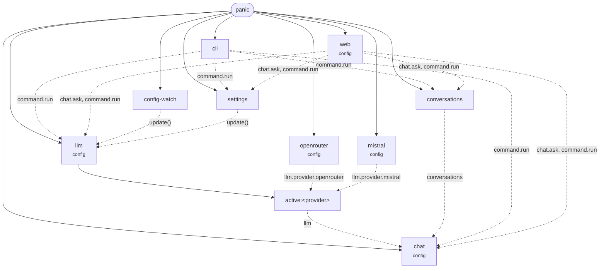

<!-- prettier-ignore -->
<div align="center">


# Panic

*An LLM assistant, in the terminal and the browser, built as a tree of hot-swappable plugins on the z lifecycle kernel*

[](https://github.com/iimvh/agent-panic/actions/workflows/ci.yml)
[](https://adoptium.net)
[](https://gradle.org)
[](https://github.com/iimvh/z)
[](https://openrouter.ai)
[](https://mistral.ai)
[](https://svelte.dev)

[Overview](#overview) • [Getting started](#getting-started) • [Usage](#usage) • [How it works](#how-it-works) • [Writing a plugin](#writing-a-plugin) • [Project structure](#project-structure) • [Development](#development) • [Troubleshooting](#troubleshooting)

</div>

## Overview

**Panic** is a chat assistant where every part of the app is a **plugin** in a lifecycle tree. Plugins never call each other directly. They talk through **services**, **hooks** and **events** from [z](https://github.com/iimvh/z), a small Java kernel inspired by [cordis](https://github.com/cordiverse/cordis).

Because of that, the tree heals itself. Remove an API key and the parts that need an LLM stop. Add it back and they start again. Switch model while chatting and only the affected branch restarts, so the conversation is kept.

- **Two providers out of the box:** [OpenRouter](https://openrouter.ai) and [Mistral](https://mistral.ai), both through one OpenAI-compatible client.
- **Streaming replies.** Answers stream over SSE, and stopping a reply aborts its HTTP request.
- **Plugins are discovered.** Drop a module into `plugins/` and it is built, found and installed. Its config is the `panic.json` section with its name, and no wiring code is needed.
- **Hot reload.** Save `panic.json` and only the plugins whose section changed are reconfigured, installed or removed.
- **Koishi-style commands.** Each plugin declares its own commands, and a command exists only while its plugin runs.
- **Two front-ends, both plugins.** A terminal CLI (interactive or one command at a time) and a web UI. Both own no feature: they run whatever the other plugins offer right now.
- **Minimal stack.** Plain Java 21 and Gradle, with Jackson as the only library. The web UI is a SvelteKit SPA of about 190 KB, packed into the jar.

> [!NOTE]
> The rebuild is in progress. It covers LLM providers, the chat bot, the CLI and the web UI. Agents come in a later stage.

## Getting started

### Prerequisites

- **JDK 21.** If the machine only has a JRE, Gradle finds or downloads a JDK through `gradle/gradle-daemon-jvm.properties`.
- **Node.js 20+** to build the web UI. Without it, pass `-PskipUi`: everything else still builds, and the server shows a "UI not built" page.
- **An API key** from [OpenRouter](https://openrouter.ai/keys) (free models are available) and/or [Mistral](https://console.mistral.ai/api-keys).

### Install

z is a git submodule, so clone with `--recurse-submodules`:

```bash
git clone --recurse-submodules https://github.com/iimvh/agent-panic.git
cd agent-panic
```

> [!TIP]
> Already cloned without submodules? Run `git submodule update --init`.

### Configure

```bash
cp panic.example.json panic.json
export OPENROUTER_API_KEY=sk-or-...   # and/or MISTRAL_API_KEY
```

`panic.json` is git-ignored. It has **one section per plugin, named after the plugin**. A missing section means the plugin's defaults, and `false` turns the plugin off. Any string can reference an environment variable as `${NAME}`, so keys stay out of the file:

```json
{
  "openrouter": { "apiKey": "${OPENROUTER_API_KEY}" },
  "mistral": { "apiKey": "${MISTRAL_API_KEY}" },
  "llm": { "provider": "openrouter", "model": "meta-llama/llama-3.3-70b-instruct:free", "temperature": 0.2, "maxTokens": 4096 },
  "chat": { "systemPrompt": "You are Panic, a concise and helpful assistant.", "maxHistory": 40 },
  "web": { "enabled": false, "host": "127.0.0.1", "port": 8080 }
}
```

| Key | Meaning |
| --- | --- |
| `openrouter.apiKey`, `mistral.apiKey` | Credential. If it is blank, the provider is not connected. |
| `openrouter.baseUrl`, `mistral.baseUrl` | Optional endpoint override, for example a proxy. |
| `llm.provider`, `llm.model` | The provider and model to chat with. |
| `llm.temperature`, `llm.maxTokens` | Default options. Leave them out to use the provider's defaults. |
| `chat.systemPrompt` | System message sent with every request. |
| `chat.maxHistory` | Number of past messages sent with each request. `0` sends them all. |
| `web.enabled`, `web.host`, `web.port` | Start the web UI with the REPL, and where it listens. `--web` and `--serve` turn it on regardless. |
| `settings`, `conversations`, `cli`, ... | Any plugin can be turned off with `false`, for example `"settings": false` removes the `/provider` and `/model` commands. |

The older layout with a `"providers": { ... }` group is still accepted.

> [!TIP]
> Without `panic.json`, Panic reads `OPENROUTER_API_KEY`, `MISTRAL_API_KEY` and `PANIC_MODEL` from the environment.

### Run

```bash
./gradlew :app:run -q --console=plain
```

Or build a launcher once and run it directly:

```bash
./gradlew :app:installDist
app/build/install/app/bin/app                        # interactive chat in the terminal
app/build/install/app/bin/app --serve                # web UI only: open http://127.0.0.1:8080
app/build/install/app/bin/app --web                  # terminal and web UI together
app/build/install/app/bin/app models free            # run one command and exit
app/build/install/app/bin/app -c other.json ask "Explain SSE in one line"
```

> [!WARNING]
> The web UI has no authentication. Keep `web.host` on `127.0.0.1` unless the machine sits behind something that adds authentication.

## Usage

```text
panic — type a message, or /help
provider: openrouter   model: meta-llama/llama-3.3-70b-instruct:free   (connected)

> What is a virtual thread?
A lightweight thread managed by the JVM rather than the OS...
[meta-llama/llama-3.3-70b-instruct:free · 184 tokens]

> /provider mistral
> /model mistral-small-latest
```

Plain text runs `ask`. In the REPL, commands start with `/`. On the command line, leave out the `/` (`panic models free`).

| Command | Declared by | Available |
| --- | --- | --- |
| `ask <text...>` | `chat` | while an LLM is connected |
| `models [filter]` | `llm` → `active:<provider>` | while the provider is connected. `filter` is `free` or part of an id. |
| `check` | `llm` → `active:<provider>` | while the provider is connected |
| `status` | `llm` | always |
| `provider [id]`, `model [id]` | `settings` | always |
| `reset` | `conversations` | always |
| `help [command]`, `exit` | `cli` | always (`exit` in the REPL only) |

`/help` lists only the commands that are available at that moment. One-shot mode exits with code `0` on success, `1` on failure and `2` for an unknown command or bad arguments. Ctrl+C shuts down cleanly in both modes.

Edit `panic.json` while Panic is running and the change is applied as soon as you save. Only the plugins whose section changed are restarted. A model picked with `/model` stays selected when you edit other sections of the file.

### Web UI

Run `panic --serve` and open `http://127.0.0.1:8080`:

- **Streaming chat** with Markdown, code blocks and a copy button. **Stop** aborts the answer, and the upstream request is aborted as well.
- **Settings** to pick a provider and a model. A provider without a key is shown as such, and the model list can be searched or limited to free models.
- **Commands** work as in the terminal: type `/` to get suggestions for the commands available now.
- **History** is kept per browser, so reloading the page keeps the conversation. **New chat** forgets it.

## How it works



Solid lines show ownership in the tree. Dotted lines show the services and hooks that connect plugins.

| Plugin | Role |
| --- | --- |
| `openrouter`, `mistral` | Provide `llm.provider.<id>` while they have a key. |
| `llm` | Installs `active:<provider>`, which requires that provider and provides `llm` with the chosen model and options. |
| `conversations` | Keeps chat history in memory. It does not depend on the LLM, so history survives a switch. |
| `chat` | Requires `llm` and `conversations`. Answers the `chat.ask` hook, emits `chat.turn` after each exchange and declares `ask`. |
| `settings` | Declares `provider` and `model`, which change the `llm` config at runtime through the `Configs` service. |
| `config-watch` | Watches `panic.json` and updates only the configs that changed. Runs in interactive mode only. |
| `web` | The web front-end. It serves the UI and an HTTP + SSE API built only on hooks and commands. |
| `cli` | The terminal front-end. It runs whatever commands are declared right now, and requires `App`, so it starts once the rest of the tree is installed. |

### Commands

Commands are declared with a Koishi-style spec. `<arg>` is required, `[arg]` is optional, and `[rest...]` takes the rest of the line as typed:

```java
Commands.command(ctx, "models [filter]", "list the provider's models", call -> {
  for (ModelInfo m : provider.models(call.signal())) call.out().println(m.id());
});
```

Each command is registered as a z hook in the declaring plugin's context. Disposing that plugin removes the command, after waiting for any run still in progress. A plugin that declares commands does not depend on the CLI, and the CLI does not depend on any feature plugin.

The z kernel provides these guarantees, so Panic has no code for them:

- **Dependents stop first.** When a provider is retracted, `chat` stops before `llm` does.
- **Requests are owned by the tree.** Every web request runs as a task of the `web` plugin. Changing `web.port` or shutting down cancels the answers in flight, waits for them, then moves or stops the server.
- **Commands follow their plugin.** When a provider loses its key, `models`, `check` and `ask` disappear with it.
- **Nothing runs after teardown.** A reply that is still streaming is cancelled, and teardown waits for it to return.
- **Restarts stay in one branch.** Changing a config restarts only that plugin and the plugins that depend on it.

## Writing a plugin

> [!IMPORTANT]
> Everything in Panic is a plugin. [AGENTS.md](AGENTS.md) holds the rules every contributor (human or coding agent) follows: when to use a service, hook, event, command or config, the dependency direction between modules, and the checklist for a new plugin. `ConventionsTest` enforces the rules that can be checked automatically.

A plugin module is a folder in `plugins/`. Gradle includes it, the app depends on it, and the app installs its plugins at startup. Nothing else has to be edited.

```text
plugins/memory/
├── build.gradle.kts
└── src/main/
    ├── java/panic/memory/MemoryPlugin.java, MemoryPlugins.java
    └── resources/META-INF/services/panic.plugin.PluginSet    ← one line: panic.memory.MemoryPlugins
```

```kotlin
// build.gradle.kts
plugins {
    id("java-conventions")
    `java-library`
}

dependencies {
    api(project(":sdk"))    // or :llm / :chat to use their services and hooks
}
```

```java
public record MemoryConfig(int limit) {
  public static final MemoryConfig DEFAULT = new MemoryConfig(100);
}

public final class MemoryPlugins implements PluginSet {
  public List<PluginSpec<?>> plugins() {
    return List.of(PluginSpec.of("memory", MemoryConfig.class, MemoryConfig.DEFAULT, MemoryPlugin::new));
  }
}

public final class MemoryPlugin implements ConfigPlugin<MemoryConfig> {
  public List<ServiceKey<?>> requires() {
    return List.of(Conversations.KEY);   // runs only while these exist
  }

  public Disposable apply(Context ctx, MemoryConfig cfg) {
    Commands.command(ctx, "remember <text...>", "keep a note", call -> { /* ... */ });
    return null;                          // or the cleanup to run when the plugin stops
  }
}
```

The plugin's config is now the `"memory": { "limit": 50 }` section of `panic.json`, and its `/remember` command appears in the CLI and the web UI. What a plugin can use:

| From | What |
| --- | --- |
| z (`context.Context`) | `provide` / `requires` services, `hook` / `bail`, `on` / `emit` events, `spawn` tasks, child plugins |
| `panic.command.Commands` | Declare commands that live as long as the plugin |
| `panic.plugin.Configs` | Read or change another plugin's config at runtime |
| `panic.plugin.App` | The terminal and `exit()`. It is provided last, so requiring it means "start once the whole tree is installed" |
| `:llm`, `:chat` | `Llm.KEY`, `Providers.key(id)`, `Chat.ASK`, `Chat.TURN`, `Conversations.KEY` |

A module may declare several plugins. For example `:llm` declares `openrouter`, `mistral`, `llm` and `settings`. A plain plugin without config uses `PluginSpec.of(name, Supplier<Plugin>)`.

## Project structure

```text
├── sdk/              panic.command  Commands, Command (spec parsing, argument binding), Session, Out
│                     panic.plugin   PluginSpec, PluginSet, Configs, App
├── plugins/
│   ├── llm/          panic.llm      openrouter, mistral, llm, settings; OpenAiCompatClient (SSE, cancellable)
│   ├── chat/         panic.chat     conversations, chat; Chat (hook ASK, event TURN)
│   ├── cli/          panic.cli      cli: REPL and the one-shot runner
│   └── web/          panic.web      web: HTTP + SSE API, static files; builds and packs ui/
├── ui/                              SvelteKit SPA: lib/api.ts, lib/chat.svelte.ts, lib/markdown.ts, components/
├── app/              panic.app      Panic (discovers PluginSets), PluginHost (configs by name), ConfigLoader, ConfigWatch, Main
├── buildSrc/                        Shared conventions: Java 21, -Xlint:all -Werror, JUnit 5
└── z/                               The z kernel (git submodule, consumed as a Gradle composite build)
```

## Development

```bash
./gradlew check            # all tests, builds the UI
./gradlew check -PskipUi   # without Node
```

Compiler warnings are errors. The tests run against local fake HTTP servers, so they need no network and no API keys. They cover the SSE parser, content normalization, request cancellation, provider switching and retraction, chat history, the command system, hot reload, and end-to-end REPL and one-shot runs.

### Working on the UI

Run the server and the Vite dev server side by side. The dev server proxies `/api` to the Java server:

```bash
app/build/install/app/bin/app --serve   # terminal 1
cd ui && npm install && npm run dev     # terminal 2: http://localhost:5173
npm run check && npm test               # svelte-check and the unit tests (Markdown, SSE parser)
```

The API is small and uses only plain JSON and SSE:

| Endpoint | |
| --- | --- |
| `GET /api/state` | Provider, model, connection, providers and the commands available now |
| `GET /api/models?filter=` | Models of the connected provider (`free`, or part of an id) |
| `GET /api/history?session=` | A session's conversation |
| `POST /api/chat` `{session, text}` | SSE: `delta`… then `done`, `unavailable`, `error` or `cancelled` |
| `POST /api/command` `{session, line}` | SSE: command output as `delta`… then `done`, `unknown`, `usage` or `error` |
| `PUT /api/settings` `{provider?, model?}` | Switches provider or model and returns the new state |

To add a provider, write a `ConfigPlugin<ProviderConfig>` that provides `Providers.key("<id>")` and answers the `Providers.STATUS` hook, then list it in a `PluginSet`. For an OpenAI-compatible API, extend `OpenAiCompatProvider`. [`Mistral.java`](plugins/llm/src/main/java/panic/llm/Mistral.java) is a complete example in about 50 lines.

## Troubleshooting

> [!WARNING]
> **`Toolchain installation ... does not provide the required capabilities: [JAVA_COMPILER]`**
> Gradle is running on a JRE. Keep `gradle/gradle-daemon-jvm.properties` in place so Gradle can pick or download a JDK 21, or point `JAVA_HOME` at a JDK. Then run `./gradlew --stop` and try again.

- **`web: cannot listen on 127.0.0.1:8080`.** The port is taken. Set `web.port` in `panic.json`.
- **The page says "UI not built".** The jar was built with `-PskipUi`. Rebuild with Node installed, or use `npm run dev` in `ui/`.
- **`[no LLM connected]`.** The selected provider has no key, or no provider is selected. Run `/status`, then set the key or use `/provider`.
- **`openrouter answered 404: No endpoints found ...`.** The model id is wrong or the model is no longer available. Run `/models free` to see what you can use.
- **`z` directory is empty.** Run `git submodule update --init`.
