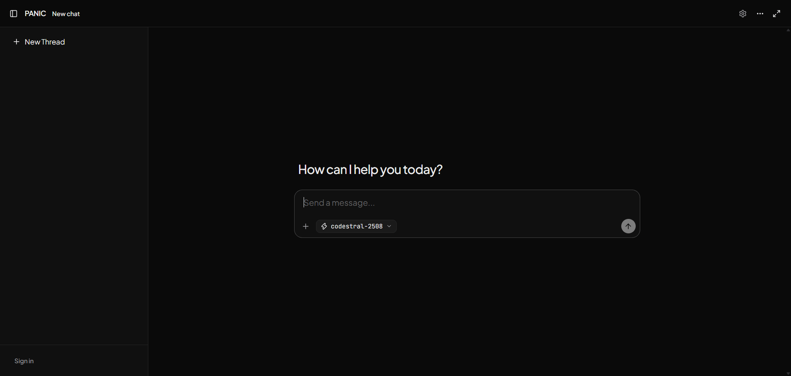
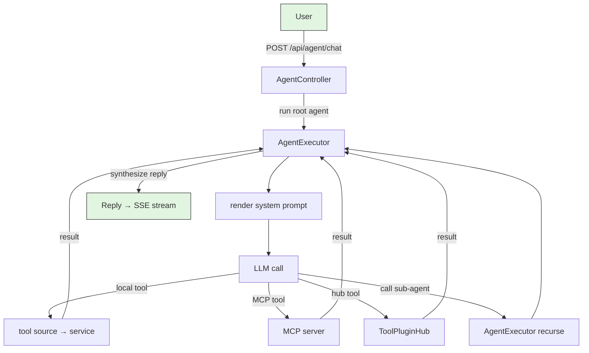

<!-- prettier-ignore -->
<div align="center">


# Panic

*Multi-agent assistant with self-describing agent plugins on Spring Boot and Spring AI*

[](https://openjdk.org)
[](https://spring.io/projects/spring-boot)
[](https://spring.io/projects/spring-ai)
[](https://react.dev)
[](https://openrouter.ai)

[Features](#features) • [Architecture](#architecture) • [Quick start](#quick-start) • [Building an agent](#building-an-agent) • [Tool-plugin hub](#tool-plugin-hub) • [Provider & configuration](#provider--configuration) • [Endpoints](#endpoints) • [Project structure](#project-structure) • [Testing](#testing) • [Roadmap](#roadmap) • [Troubleshooting](#troubleshooting)

</div>

**Panic** is a multi-agent chat assistant that treats every agent as a **self-describing plugin**. There is a single `Agent` type; a coordinator is just an agent with sub-agents, so trees nest recursively without limits.

Agents are discovered from `agents/*/agent.yaml` on the classpath, so **installing an agent means adding its module dependency** — no wiring code to edit anywhere. The runtime is framework-only: it knows how to run agents, not what they do.

> [!NOTE]
> Author: **iimvh** — https://github.com/iimvh
>
> This repository is a working reference implementation. The bundled `coordinator` + example `echo` agent show the module contract; domain agents are added as their own modules.

<p align="center">

<br/>
<em>1. Chat workspace · 2. User sends "echo: hello from panic" · 3. Pipeline trace expanded: coordinator delegates to echo sub-agent</em>
</p>

## Features

- **One agent type, recursive**: `AgentDefinition` is the single source of truth (`id`, `description`, `prompt`, `tools`, `subAgents`, `skills`, `hubTools`, `policy`).
- **Plugin modules**: each agent is a Maven module holding `agent.yaml` + `system.md` + its tool beans.
- **Prompt rendering every turn**: `{now}`, `{today}`, `{tools}`, `{subAgents}`, `{skills}` are re-rendered on each LLM call.
- **Scoped tool names**: tools are prefixed `<agentId>__<tool>` and each sub-agent is mounted as exactly one `call_<id>` tool, so names never collide.
- **Progressive skills**: markdown skills are exposed as `name + description`; the LLM loads full content on demand via `load_skill`.
- **Realtime pipeline**: the chat endpoint streams every step (LLM calls, tool calls, sub-agent nesting) over SSE using the AG-UI protocol.
- **Safe by default**: depth/chain guardrails block loops, structural errors fail fast at startup, and a disabled or missing agent degrades gracefully.
- **Conversation sessions**: every chat is a server-persisted session — list, replay (answer + pipeline trace), rename and delete survive restarts, browsers and machines; a `＋ new chat` detaches with a clean context.
- **Redis accelerator (optional)**: recent-turn hot cache, chat rate limit and per-conversation run lock via Upstash REST (TCP fallback); unreachable Redis never breaks a task.
- **Tool-plugin hub**: common capabilities (web search) are authored once and granted per agent via `hubTools`; the bundled `web-search` plugin defaults to Google News RSS (dated items, no API key).
- **Multi-provider runtime config**: OpenRouter and Mistral are connected through the UI Settings panel and stored in H2 — no `.env` key is read; a save applies from the next request on.

## Architecture

| Component | Implementation |
|---|---|
| User interface | React + Vite + Tailwind SPA (`web/`, built into `panic-app/src/main/resources/static`) |
| API | `AgentController` — `POST /api/agent/chat` (SSE/AG-UI entry point); `ConversationController` — `POST/GET/PATCH/DELETE /api/conversations` (session sidebar); `LlmProviderController` — `GET/POST /api/provider`, `GET /api/provider/models` |
| Agent runtime | `panic-core`: `AgentRegistry`, `AgentExecutor`, `AgentPromptRenderer`, pipeline recorder |
| Agent SPI | `Agent`, `AgentDefinition`, `ToolSource`, `ToolPlugin`, `Skill`, `AgentPolicy`, `AgentContext` |
| Bundled agents | `coordinator` (`panic-agents-core`) + `echo` (`panic-agent-example`) + `digest` (`panic-agent-digest`) |
| Tools | local (`@Tool` / `ToolCallback`) or MCP server |
| Storage | H2 (file-based) by default; Postgres with the `postgres` profile — conversations, turns and pipeline traces |
| Accelerator | Upstash Redis over REST (TCP fallback) — window cache, chat rate limit, per-conversation lock; all optional |
| Observability | Actuator — `/actuator/health`, `/actuator/agents` |

### Request flow



The tree ships with two example branches:

```
coordinator                  (no tools of its own)
├── echo                     echo__echo   (example module)
└── digest                   digest__webSearch (tool-plugin hub: web-search)
```

## Quick start

### Prerequisites

- **JDK 21+**
- **Maven 3.8+**
- **Node.js 20+** (only to build the UI)
- An **OpenRouter API key** — the app still starts without one, but chat returns a clear error

### Run

```bash
git clone https://github.com/iimvh/agent-panic.git
cd agent-panic

mvn -q clean package
java -jar panic-app/target/panic-app-1.0.0.jar
```

Open <http://localhost:8080> and start chatting. The UI is already bundled into the app.

> [!TIP]
> The LLM provider (API key + model) is configured in the app itself: open the
> ⚙ Settings icon in the sidebar, connect the OpenRouter provider and pick a
> free model from the composer's selector. No `.env` / environment key is read.

### Run from source

```bash
# The provider is set up in the UI (Settings panel); no key export is needed.

# Backend (always with -am so the latest core is built)
mvn -pl panic-app -am spring-boot:run

# Frontend in a second terminal
cd web
npm install
npm run dev        # http://localhost:5173, proxies /api -> :8080
```

`dev.ps1` wraps the common commands on Windows:

```powershell
./dev.ps1 build      # mvn -o clean package
./dev.ps1 app        # run the app
./dev.ps1 test       # test panic-core
./dev.ps1 ui         # build the frontend into panic-app/src/main/resources/static
```

### Optional: Redis accelerator

Set either pair to enable hot cache, rate limit and per-conversation run lock:

```bash
# Upstash REST (preferred)
export UPSTASH_REDIS_REST_URL=https://...
export UPSTASH_REDIS_REST_TOKEN=...

# or TCP fallback
export REDIS_URL=redis://localhost:6379
```

The app starts and works fine without Redis — degradation is fail-open.

## Building an agent

An agent lives in its own module and declares itself in two files plus a bean:

**`src/main/resources/agents/<id>/agent.yaml`**

```yaml
id: greeting
description: Greets users and answers general questions.
prompt: "system.md"                 # relative to agents/<id>/
skills: []
subAgents: []
tools: [local:greeting-tools]     # local:<toolSourceId>
hubTools: []                      # common tools from the tool-plugin hub
```

**`src/main/resources/agents/<id>/system.md`** — the prompt template, re-rendered every turn:

```markdown
You are the greeting agent. Answer in one short sentence.
The current time is {now}.
```

**The module bean** registers the definition and its tool source:

```java
@Configuration
@ConditionalOnProperty(name = "app.agents.greeting.enabled", havingValue = "true", matchIfMissing = true)
public class GreetingAgentConfig {

    @Bean
    public AgentDefinition greetingAgent() {
        return AgentDefinition.builder("greeting")
                .description("Greets users and answers general questions.")
                .promptFile("agents/greeting/system.md")
                .build();
    }

    @Bean
    public AgentToolSources greetingToolSources(GreetingTools tools) {
        return new AgentToolSources().local(LocalToolSource.of("greeting-tools", tools));
    }
}
```

Finally add the module to `panic-app/pom.xml` and mount it where you want it:

```yaml
# panic-agents-core/src/main/resources/agents/coordinator/agent.yaml
subAgents: [echo, greeting]
```

That is the whole contract — nothing in `panic-core` changes. Removing the agent is dropping the dependency (or setting `app.agents.greeting.enabled=false`).

### Agent fields

| Field | Meaning |
|---|---|
| `id` | Unique identifier; used as the tool prefix (`<id>__<tool>`) |
| `description` | One sentence the parent LLM reads to decide whether to delegate |
| `prompt` | Markdown file re-rendered every turn |
| `tools` | `local:<toolSourceId>` entries resolved against `AgentToolSources` |
| `subAgents` | Each sub-agent becomes exactly one `call_<id>` tool; empty = leaf |
| `hubTools` | Common tool-plugin ids (e.g. `web-search`) validated against the hub at startup |
| `skills` | Unlocks the `load_skill` tool |
| `policy` | `maxDepth`, `timeoutMs`, `maxToolCalls` |

## Tool-plugin hub

Common capabilities are contributed once by `ToolPlugin` beans and granted to agents by id through `hubTools`. Granted plugins are mounted at run time prefixed `<agentId>__`, exactly like built-in tools, so names never clash across agents.

The bundled module `panic-tool-plugins` contributes:

| Plugin id | Description | Backend |
|---|---|---|
| `web-search` | Search the latest news and public web (title, url, published time, snippet) | Google News RSS by default (`app.tools.web-search.backend` = `google-news` \| `bing` \| `duckduckgo`) |

The digest agent (`panic-agent-digest`) is granted `hubTools: [web-search]` and owns no tools of its own — it searches and reports dated news in the user's language.

If a declared hub tool is missing from the classpath, the app **fails fast at startup**.

## Skills

A skill is a markdown file with frontmatter under `agents/<agentId>/skills/*.md`:

```markdown
---
name: "booking-policy"
description: "Rules the agent can load on demand"
mcpServers: []
---
<procedure content>
```

The prompt only shows `name + description`; the LLM calls `load_skill(skillId)` when it needs the body. A file missing `name` is skipped with a warning.

## MCP

The bundled agents declare no MCP tools, so the client is disabled by default. To use an MCP server, wrap any `ToolCallbackProvider` in an `McpToolSource`, mount it on an agent with `.toolSources(...)`, and reference it from `agent.yaml`:

```properties
spring.ai.mcp.client.enabled=true
spring.ai.mcp.client.sse.connections.<name>.url=http://localhost:8081/sse
```

If the server is unreachable the app logs a warning and the agent degrades — it does not crash.

## Provider & configuration

The provider connection is data, not environment: `llm_provider_config` (H2) holds the active OpenRouter row — its API key and the selected free model. The Settings panel writes it through `PUT /api/provider`, the composer reads free models through `GET /api/provider/models`, and `AgentExecutor` resolves the active connection on every run (a save applies from the next request on).

`panic-app/src/main/resources/application.properties`:

```properties
spring.ai.openai.base-url=https://openrouter.ai/api   # no /v1: Spring AI appends it
spring.ai.openai.api-key=missing-openrouter-api-key   # placeholder only, so the app boots
app.provider.chat-temperature=0.2
app.provider.chat-max-tokens=4096
app.agents.root=coordinator
app.memory.window-turns=20
```

| Environment variable | Purpose |
|---|---|
| `DB_HOST` / `DB_PORT` / `DB_NAME` / `DB_USER` / `DB_PASSWORD` | Postgres for the `postgres` profile (see below) |
| `UPSTASH_REDIS_REST_URL` / `UPSTASH_REDIS_REST_TOKEN` | Upstash Redis REST accelerator (optional) |
| `REDIS_URL` | TCP Redis fallback when the REST credentials are absent |

The placeholder OpenAI key only keeps the auto-configured beans alive until a provider is connected; agents then answer `No LLM provider connected` in chat while none is.

### Store of record

H2 (file-based, zero config) is the dev default. For a durable Postgres (e.g. the Aiven instance in `.env`), run with the `postgres` profile — the schema appears on first boot via `ddl-auto=update`:

```bash
java -jar panic-app/target/panic-app-1.0.0.jar --spring.profiles.active=postgres
```

Agents can be enabled or disabled with `app.agents.<id>.enabled`:

```bash
APP_AGENTS_ECHO_ENABLED=false mvn -pl panic-app -am spring-boot:run
curl -s localhost:8080/actuator/agents   # echo is gone from the tree
```

Structurally invalid declarations (cycles, duplicate ids) **fail fast** at startup. A sub-agent whose module is missing is **not** an error: it is dropped and listed under `missingSubAgents`.

## Endpoints

```
POST /api/agent/chat     # { "threadId": "...", "messages": [...] } → SSE stream (AG-UI)
POST /api/conversations  # → 201 { "id": "..." } — new empty session
GET  /api/conversations   # → [ { id, title, lastActivityAt } ] — newest activity first
GET  /api/conversations/{id}  # → { id, title, turns: [{ task, answer, status, at, pipeline }] } — replay
PATCH /api/conversations/{id}  # { "title": "..." } → renamed summary
DELETE /api/conversations/{id}  # → 204; 404 unknown, 409 while a task runs the session
GET  /api/provider      # connected provider status
POST /api/provider      # connect/switch provider (key + model)
GET  /api/provider/models # free OpenRouter models for the composer selector
GET  /actuator/health
GET  /actuator/agents    # runtime agent tree, tools, skills and policy
```

### Chat example

Request:

```bash
curl -N http://localhost:8080/api/agent/chat \
  -H "Content-Type: application/json" \
  -H "Accept: text/event-stream" \
  -d '{"threadId":null,"messages":[{"id":"1","role":"user","content":"coffee please"}]}'
```

Sample SSE events:

```
event: RUN_STARTED
data: {"threadId":"abc-123","runId":"trace-7","timestamp":"2026-11-08T16:42:00Z"}

event: CUSTOM
data: {"type":"panic.pipeline","phase":"MESSAGE","status":"OK","actor":"user","preview":"coffee please","payload":{"text":"coffee please"}}

event: CUSTOM
data: {"type":"panic.pipeline","phase":"TOOL","status":"OK","actor":"coordinator","name":"call_echo","payload":{"args":{"query":"coffee please"}}}

event: TEXT_MESSAGE_CONTENT
data: coffee please

event: TEXT_MESSAGE_END
data: null

event: RUN_FINISHED
data: {"traceId":"trace-7","durationMs":1240}
```

The chat response is `text/event-stream`:

1. `RUN_STARTED` — `threadId` + `runId` (= traceId), flushed immediately.
2. Pipeline frames — one event per step as it happens (`parentId`, `agentId`, `depth` allow the UI to draw the tree).
3. `RUN_FINISHED` — final answer plus metadata (traceId, durationMs); `RUN_ERROR` when the turn fails.

## Project structure

```
panic-core/            framework runtime, SPI, pipeline, memory, skills, tool-plugin hub, LLM provider store
panic-agents-core/     base-product agents (coordinator)
panic-tool-plugins/    tool-plugin hub: common tools any agent can be granted (web-search)
panic-agent-example/   echo — reference module to copy when adding an agent
panic-agent-digest/    digest editor — summarizes + presents web-search results
panic-app/             entry point, configuration, bundled UI, installed agent modules
web/                   React + Vite + Tailwind chat SPA (assistant-ui + AG-UI protocol)
```

> [!IMPORTANT]
> `panic-core` may be edited to add a **capability** (tool streaming, new SPI, a guardrail hook). It must not be edited for one agent's prompt, tools or domain logic — those belong in an agent module.

## Testing

```bash
mvn -q test                              # all modules
mvn -q -pl panic-core test               # core runtime only
mvn -q -pl panic-app -am test            # end-to-end agent wiring
```

The suite covers registry validation, the executor's tool/sub-agent loop, prompt rendering, skill loading, the web-search backends, the Spring AI array-content workaround, and the app-level wiring of `coordinator → echo → digest`.

## Roadmap

The following are intentionally deferred to keep this reference implementation focused on the agent plugin contract:

- Spring Security / JWT authentication (API is open by design in MVP)
- PII redaction, cost tracking, per-tenant MCP sessions
- Hot-loading plugins / dynamic module discovery at runtime
- Multi-user realtime support and presence
- Aiven Postgres production deployment (`.env` documents the target)

## Troubleshooting

| Symptom | Fix |
|---|---|
| Chat returns `No LLM provider connected` | Open the ⚙ Settings panel in the sidebar and connect the OpenRouter provider |
| 400/422 with a model/tool error | Pick a model that supports tool calling in the composer's model selector |
| Agent missing from the tree | Add its module to `panic-app/pom.xml`, or check `app.agents.<id>.enabled` |
| Stale JAR after changing core | Always run module commands with `-am` |
| UI changes not visible | Rebuild with `./dev.ps1 ui` (or `npm run build`) and restart the app |
| Duplicate agent id / cycle at startup | Fix `agent.yaml` declarations — both fail fast |
| Redis unreachable | App runs without Redis; unset `UPSTASH_*` / `REDIS_URL` |
